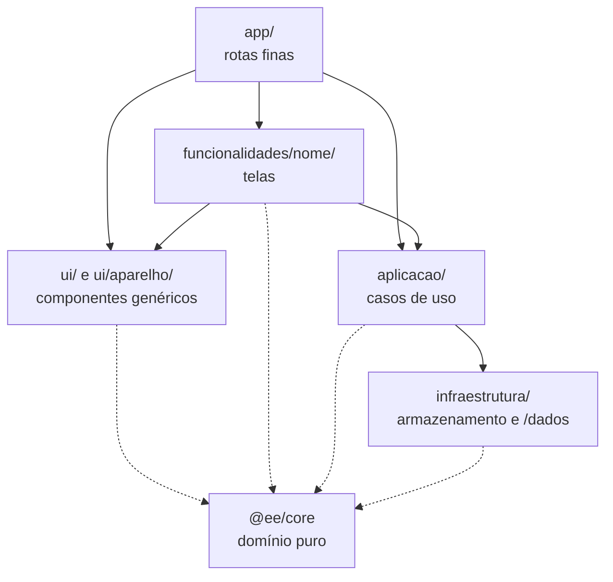

# Arquitetura

## Visão geral

```
            ANEEL (dados abertos)   IBGE (cópia local)
                       │                 │
                       ▼                 ▼
          packages/dados  ── rotina diária (GitHub Actions) ──┐
                                                              ▼
                                  apps/web/public/dados/*.json (commit no main)
                                                              │
                     Vercel faz o deploy a cada commit ───────┤
                                                              ▼
   Navegador da pessoa ── lê /dados ── calcula com @ee/core ── guarda a casa no localStorage
```

Hoje não existe servidor próprio nem banco: todo dado da casa fica no aparelho da pessoa. A conta opcional
(Supabase) entra no épico E4 e só envia dados com o consentimento da pessoa.

## Pacotes

| Pacote | Responsabilidade | Depende de |
| --- | --- | --- |
| `packages/core` (`@ee/core`) | Domínio: tipos, cálculos de consumo e custo, catálogo de aparelhos e variantes, cômodos, dicas e plano, Tarifa Social, consumo mínimo, formatação | nada |
| `packages/dados` | Baixar, ler, cruzar e validar os dados da ANEEL/IBGE e gravar os JSON públicos | `@ee/core` (tipos) |
| `apps/web` (`@ee/web`) | Site Next.js | `@ee/core` |
| `apps/mobile` (futuro) | App Expo | `@ee/core` |

## Camadas do site

Decisão no [ADR-001](equipe/decisoes/ADR-001-camadas.md), aplicada ao código na história
[HIS-001](equipe/historias/HIS-001-camadas.md). O código do site (`apps/web/src/`) fica em seis pastas, e cada uma só
conhece as que estão abaixo dela:

```
app/                  rotas finas: só montam a tela. /, /comecar, /casa, /casa/comodos, /casa/dicas,
                      /casa/ajustes, /casa/aparelhos (leva para /casa/comodos), /sobre
funcionalidades/      uma pasta por funcionalidade, com as telas dela:
  inicio/             PaginaInicial, Simulador, BotaoComecar, CasaIlustrada
  cadastro/           Cadastro (assistente) e rascunho (a casa antes de ser criada)
  casca/              Casca: moldura da área da casa (cabeçalho, navegação, transição)
  acompanhamento/     PainelAcompanhamento (/casa) e Acompanhamento (contas e leituras)
  comodos/            TelaComodos   dicas/  TelaDicas   ajustes/  TelaAjustes
ui/                   componentes genéricos: Botao, Opcao, Pilulas, Contador, Campo, Entrada, Folha, Aviso,
                      Icone, Marca, Movimento, Barras, Etiqueta, BuscaCidade...
  aparelho/           componentes de aparelho usados por mais de uma tela: LinhaAparelho, BlocoIluminacao,
                      TempoUso, SeletorCatalogo, EditorAparelho, tipos, textosDeUso
aplicacao/            a porta das telas para os dados: casa (useCasa, useEdicaoDeAparelho, novoId), resumo
                      (useResumo), dados-publicos (useTarifas, useMunicipios), numeros-do-inicio.servidor
infraestrutura/       acesso a dados: armazenamento/casa (Zustand persist), dados-publicos/navegador (/dados),
                      dados-publicos/arquivos.servidor (leitura de disco), identificador (novoId)
config/               recursos (RECURSOS: chaves para ligar e desligar funções)
```

Quem pode importar quem:



A linha tracejada é o domínio: todas as camadas do site podem usar o `@ee/core`. `config/` também pode ser usado por
todas e não aparece no desenho. As regras, na ordem do ADR:

| Camada | Pode importar | Nunca importa |
| --- | --- | --- |
| `app/` | `app`, qualquer funcionalidade, `ui`, `aplicacao`, `config` | `infraestrutura` direto |
| `funcionalidades/X/` | a própria `X`, `ui`, `aplicacao`, `config` | outra funcionalidade, `infraestrutura` |
| `ui/` | `ui`, `config`, funções puras do `@ee/core` | estado, armazenamento, rede, `aplicacao`, `funcionalidades`, `app` |
| `aplicacao/` | `aplicacao`, `infraestrutura`, `config` | `ui`, `funcionalidades`, `app` |
| `infraestrutura/` | `infraestrutura`, `config` | qualquer camada de cima |
| `@ee/core` | só os próprios arquivos (`./`) | React, rede, armazenamento, o site |

### Decisões que valem para todo o código

- **`aplicacao/` é a única porta para `infraestrutura/`.** As telas pegam a casa (`useCasa`, `useCasaCarregada`,
  `novoId`) e os dados públicos (`useTarifas`, `useMunicipios`) de `aplicacao/`, mesmo quando é só reexportação.
  É ali que a sincronização com a conta opcional (E4) vai entrar, sem mexer nas telas.
- **Um só store da casa**, criado em `infraestrutura/armazenamento/casa.ts`. `aplicacao/casa.ts` só reexporta, com
  nome (`export { useCasa } from ...`; o Next não aceita `export *` em módulo `"use client"`).
- **Componentes de `ui/` não leem estado.** Os dados entram por propriedades e as mudanças saem por funções de retorno.
  Exemplo: o `EditorAparelho` recebe `comodos`, `aoSalvar` e `aoRemover`; quem liga o editor à casa é o hook
  `useEdicaoDeAparelho()`, usado pelo acompanhamento e pelos cômodos.
- **Código só de servidor termina em `.servidor.ts`** e começa com `import "server-only";`. Só esses arquivos, dentro de
  `infraestrutura/`, usam módulos do Node (`node:fs`). Hoje são dois: `infraestrutura/dados-publicos/arquivos.servidor.ts`
  (lê `public/dados/tarifas.json` e `relatorio.json`) e `aplicacao/numeros-do-inicio.servidor.ts` (monta os números da
  página inicial). Um arquivo com `"use client"` nunca importa um `.servidor`; se isso acontecer por um caminho indireto,
  o próprio Next 16 faz o build falhar por causa do `server-only`.
- **Sem arquivos `index.ts` que juntam exportações.** Importa-se o arquivo direto (`@/ui/Botao`). Entre pastas, sempre
  com `@/`; `./` só dentro da mesma pasta.
- **Rotas finas não têm `"use client"`.** São componentes de servidor que devolvem a tela da funcionalidade. Assim a
  página inicial continua estática e leve no celular, e o `revalidate = 86400` fica na própria rota (`app/page.tsx`),
  que é onde o Next lê a configuração de cache.

### Verificador de camadas

As regras acima são conferidas pelo script `scripts/verificar-camadas.mjs` (Node puro, sem dependência). Ele roda
sozinho com `pnpm camadas` e também dentro do `pnpm typecheck`, que o CI executa em todo push e pull request.

O script lê `apps/web/src` e `packages/core/src` e acusa: import que quebra a tabela acima; pasta antiga
(`components/`, `lib/`) ou arquivo fora das camadas; `zustand` fora de `infraestrutura/`; módulo do Node fora de
`infraestrutura/**/*.servidor.ts`; `.servidor.ts` sem `import "server-only"` como primeiro import; arquivo `"use client"`
importando `.servidor`; `require(` e `import(` sem texto fixo; e qualquer import não relativo dentro do `@ee/core`.
Se não ler nenhum arquivo, também falha: a barreira nunca diz "tudo certo" sem ter conferido.

Sem problemas, a saída é `Camadas: tudo certo (64 arquivos)` e o código de saída é 0. Com problema, uma linha por
import errado e o código 1, por exemplo:

```
apps/web/src/ui/Botao.tsx → @/aplicacao/casa: ui não pode importar aplicacao (ADR-001, regra 4)
1 problema(s)
```

Limites conhecidos (ficam para a [HIS-002](equipe/historias/HIS-002-qualidade-automatica.md), que traz o ESLint):
o script usa expressões regulares, não segue imports indiretos e deixa passar formas raras escritas de propósito
(por exemplo `from"x"` sem espaço). Na HIS-002 o ESLint assume as regras que dependem só do próprio arquivo, e o script
continua com as que precisam olhar outro arquivo ou a estrutura de pastas.

## Dados públicos

| Arquivo | Conteúdo |
| --- | --- |
| `/dados/tarifas.json` | distribuidoras (tarifa B1 vigente em R$/kWh, nome, UFs), bandeiras por mês e adicional, data de atualização |
| `/dados/municipios/{UF}.json` | municípios do estado e as distribuidoras de cada um, da que atende mais para a que atende menos |

A página inicial é estática e se atualiza uma vez por dia (`revalidate = 86400`). No servidor, ela lê `tarifas.json`
e `relatorio.json` do disco (`arquivos.servidor.ts`); se der erro, mostra números aproximados em vez de quebrar.
No navegador, as telas da casa buscam os arquivos por `/dados` (`infraestrutura/dados-publicos/navegador.ts`).

## Estado local

`useCasa` (Zustand 5 com `persist`, chave `eficiencia-energetica:casa` no localStorage, `version` 2 com `migrate`), em
`infraestrutura/armazenamento/casa.ts`: residência, cômodos, aparelhos, contas mensais, leituras do relógio e plano de
economia. Qualquer mudança de formato exige versão nova e migração testada.

## Movimento

Transições de página com `<ViewTransition>` do React 19.3 e `transitionTypes` do Next 16 (`nav-forward`, `nav-back`,
`entrar-painel`), cabeçalho e navegação fixos durante a troca, e utilidades CSS (`surgir`, `cresce-x`, `revelar`...).
Tudo desligado com `prefers-reduced-motion`.

## Segurança

Regras obrigatórias no [`CLAUDE.md`](../CLAUDE.md#segurança-obrigatório). Base de segurança do site na história
[HIS-003](equipe/historias/HIS-003-base-de-seguranca.md).
