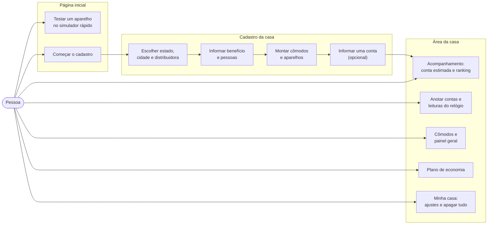
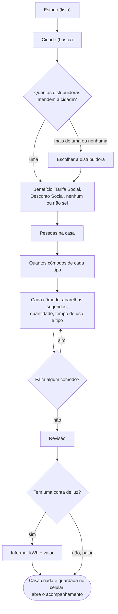
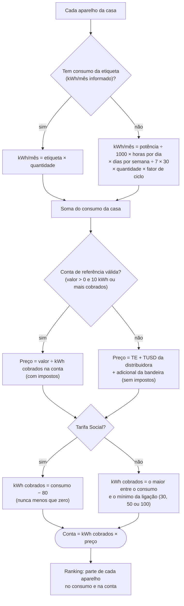
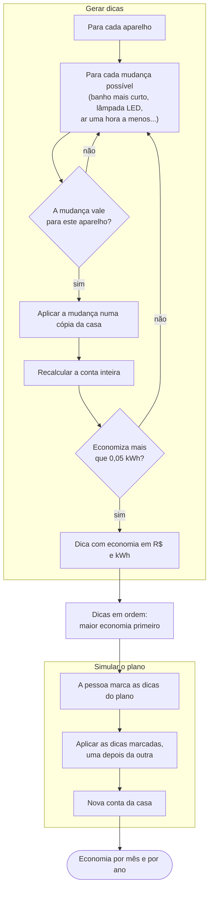
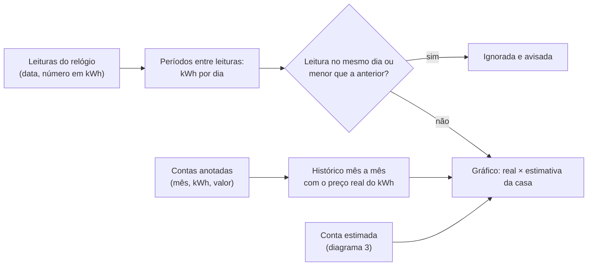
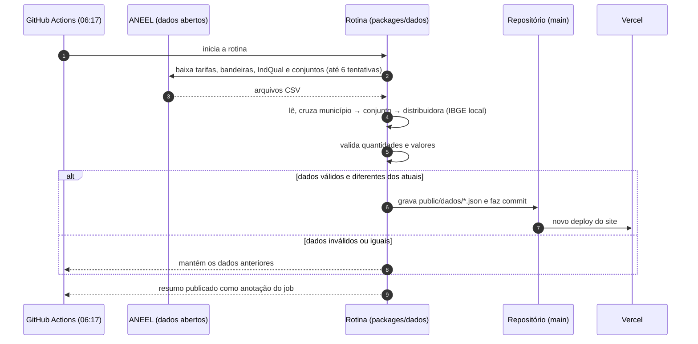
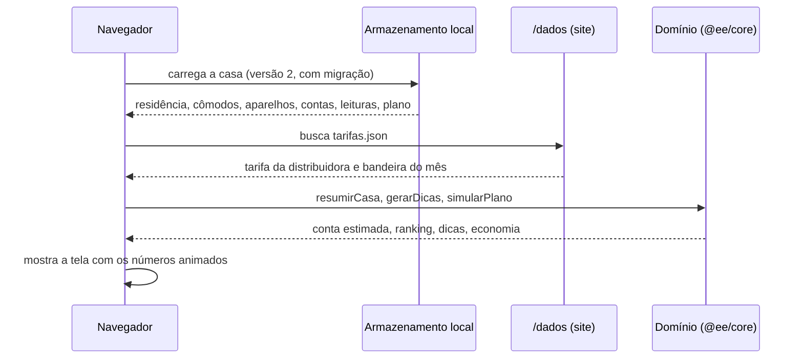
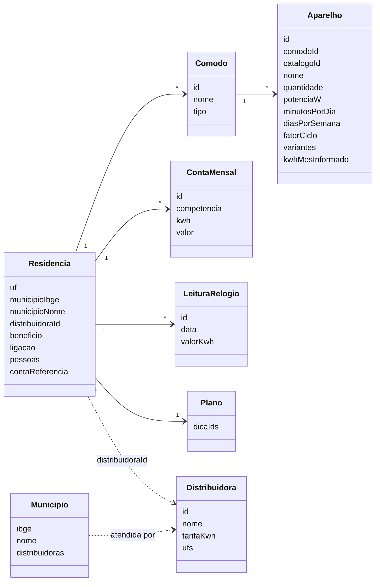

# Diagramas das funções

Os diagramas estão em [Mermaid](https://mermaid.js.org/). O GitHub desenha os diagramas direto nesta página. No VS Code,
use a pré-visualização de Markdown com a extensão "Markdown Preview Mermaid Support".

Todos refletem o código atual: domínio em `packages/core/src/`, telas em `apps/web/src/app/`, rotina em `packages/dados/src/`.

## 1. Mapa das funções

O que a pessoa pode fazer em cada tela.

## 2. Fluxo do cadastro

Uma pergunta por tela (`apps/web/src/app/comecar/Cadastro.tsx`). A distribuidora só é perguntada quando a cidade tem
mais de uma, ou nenhuma conhecida.

## 3. Cálculo da conta estimada

Funções `consumoMensalKwh`, `precoKwh`, `estimarConta` e `resumirCasa` em `packages/core/src/calculos.ts`.

Com a ligação desconhecida, o sistema assume monofásica (30 kWh), a mais comum em residências.

## 4. Dicas e plano de economia

Funções `gerarDicas` e `simularPlano` em `packages/core/src/dicas.ts`.

Aplicar uma dica depois da outra evita contar a mesma economia duas vezes. Por exemplo, banho mais curto e chuveiro
na posição verão no mesmo chuveiro.

## 5. Acompanhamento: real × estimado

Funções `historicoContas` e `periodosDeLeitura` em `packages/core/src/acompanhamento.ts`.

## 6. Rotina diária de dados

`.github/workflows/atualizar-dados.yml` e `packages/dados/src/`.

## 7. Abrir a área da casa

O que acontece no celular quando a pessoa abre o acompanhamento.

## 8. Modelo de dados

Tipos em `packages/core/src/tipos.ts`. Hoje tudo fica no navegador; a conta opcional (épico E4) usará as mesmas estruturas.

`Distribuidora` e `Municipio` vêm dos arquivos públicos em `/dados`. Os demais tipos são da casa da pessoa.
